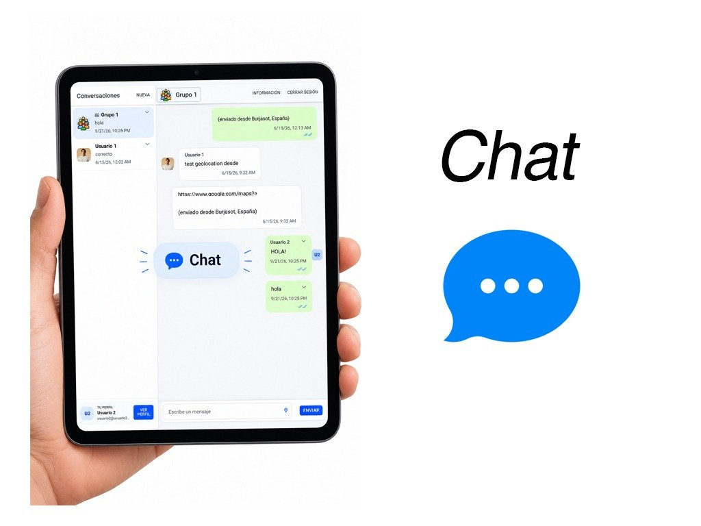
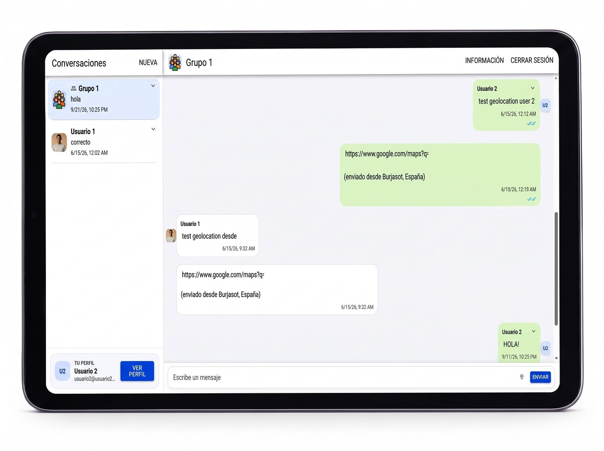
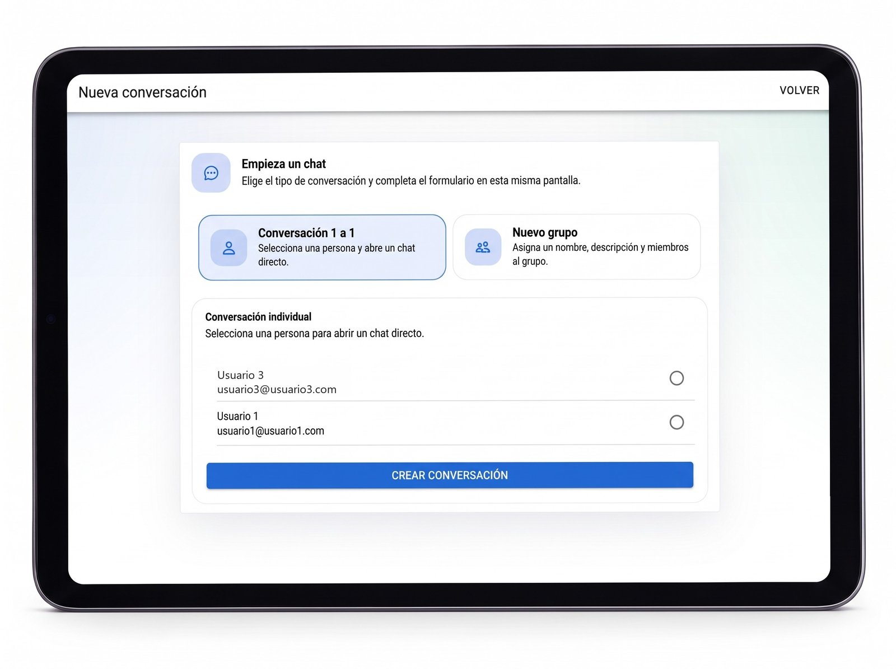
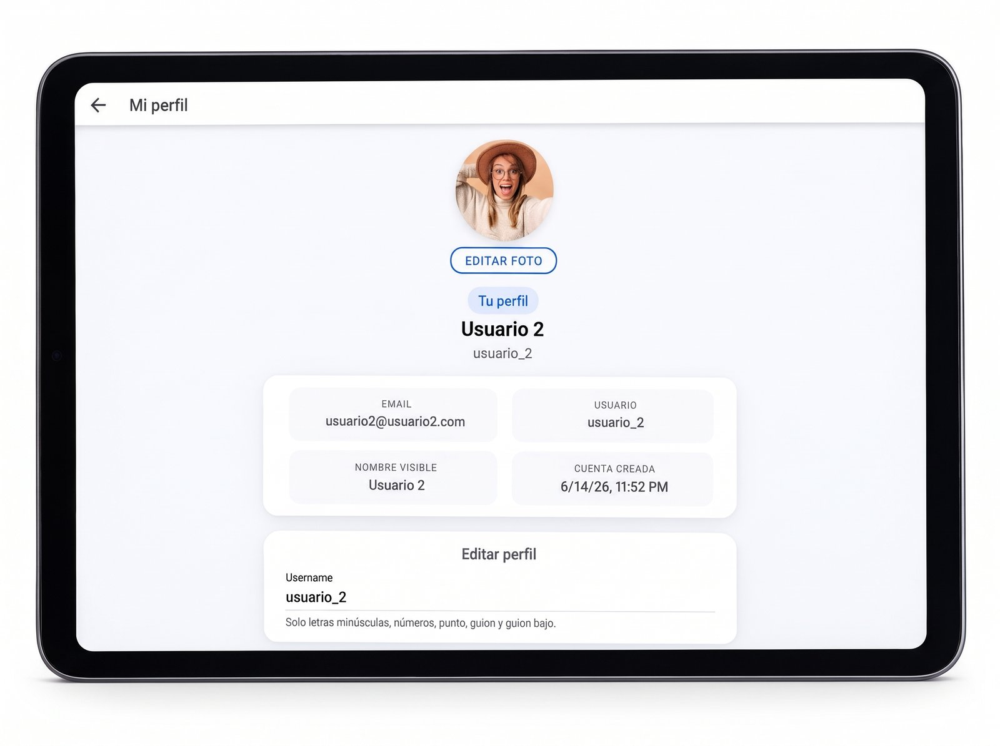

<div align="center">

# 💬 my-chat

**Aplicación de chat en tiempo real** con conversaciones individuales y de grupo, construida con Angular, Ionic y Firebase.




</div>

## ✨ Funcionalidades

- 🔐 **Autenticación** con email/contraseña y con Google.
- 👥 **Conversaciones 1 a 1 y grupos**, con roles de propietario, administrador y miembro.
- ⚡ **Mensajes en tiempo real** con estado de lectura (✓✓) y carga paginada del historial.
- 📍 **Compartir ubicación** con un toque (Capacitor Geolocation + enlace a Google Maps).
- 🙍 **Perfil editable**: foto, nombre visible, nombre de usuario y eliminación de cuenta.

## 📸 Capturas

<table>
  <tr>
    <td align="center" colspan="2">
      <br>
      <sub><b>Chat de grupo</b>: lista de conversaciones, mensajes en tiempo real y ubicación compartida</sub>
    </td>
  </tr>
  <tr>
    <td align="center" width="50%">
      <br>
      <sub><b>Nueva conversación</b>: chat individual o grupo</sub>
    </td>
    <td align="center" width="50%">
      <br>
      <sub><b>Mi perfil</b>: datos de la cuenta y edición</sub>
    </td>
  </tr>
</table>

## 🧰 Requisitos

- Node.js 20 o superior y npm
- Angular CLI (`npm install -g @angular/cli`) — opcional, se puede usar `npx ng`
- Una cuenta de Google para crear tu propio proyecto Firebase
- Firebase CLI (`npm install -g firebase-tools`) — solo para desplegar las reglas

## ⚙️ Configuración

Este repositorio **no incluye credenciales**. Cada persona debe usar su propio proyecto Firebase.

### 1. Crear el proyecto Firebase

1. Entra en <https://console.firebase.google.com> y crea un proyecto nuevo.
2. **Authentication** → *Comenzar* → habilita los proveedores **Correo electrónico/contraseña** y **Google**.
3. **Realtime Database** → *Crear base de datos* → elige la región y arranca en **modo bloqueado**.
4. **Configuración del proyecto** → *Tus apps* → añade una **app web** (`</>`). Firebase te mostrará un objeto `firebaseConfig`.

### 2. Rellenar el environment

Las plantillas están en `src/environments/`:

| Plantilla (en git)              | Archivo real (ignorado por git) | Uso                     |
|---------------------------------|---------------------------------|-------------------------|
| `environment.example.ts`        | `environment.ts`                | `ng serve` / desarrollo |
| `environment.prod.example.ts`   | `environment.prod.ts`           | `ng build` (producción) |

```bash
npm install
npm run setup:env   # copia las plantillas a environment.ts / environment.prod.ts si no existen
```

Abre `src/environments/environment.ts` y `src/environments/environment.prod.ts` y sustituye cada `YOUR_...` por el valor correspondiente del `firebaseConfig` de tu app web. `databaseURL` es la URL que aparece en la pestaña *Realtime Database*.

> `npm start`, `npm run build` y `npm test` ejecutan `setup:env` automáticamente, pero **nunca sobrescriben** un environment existente.
> No subas nunca `environment.ts` ni `environment.prod.ts`: ya están en `.gitignore`.

### 3. Reglas de seguridad y proyecto por defecto

Edita `.firebaserc` y cambia `YOUR_FIREBASE_PROJECT_ID` por el ID de tu proyecto (o ejecuta `firebase use --add`). Después, revisa `database.rules.json` y despliégalas:

```bash
firebase login
firebase deploy --only database
```

### 4. Recomendaciones de seguridad para tu proyecto

- En Google Cloud Console → *APIs y servicios* → *Credenciales*, **restringe la API key** de la app web a tus dominios (referentes HTTP) y solo a las APIs que usa Firebase.
- En **Authentication → Configuración → Dominios autorizados**, deja solo tus dominios.
- Activa **App Check** para Realtime Database.
- Las reglas incluidas exigen usuario autenticado; endurécelas por ruta (miembros de cada conversación) antes de usar la app en producción.

## 🚀 Ejecución

```bash
npm start          # servidor de desarrollo en http://localhost:4200
npm run build      # compilación de producción en ./www
npm test           # tests unitarios (Karma)
npm run lint       # ESLint
```

## 📁 Estructura

```
src/app/
  auth/      login, guard y servicio de autenticación
  chat/      conversaciones, mensajes y componentes del chat
  users/     perfil de usuario
src/environments/  plantillas de configuración (*.example.ts)
scripts/setup-env.js  genera los environments locales a partir de las plantillas
database.rules.json   reglas de la Realtime Database
docs/screenshots/     capturas usadas en este README
```
